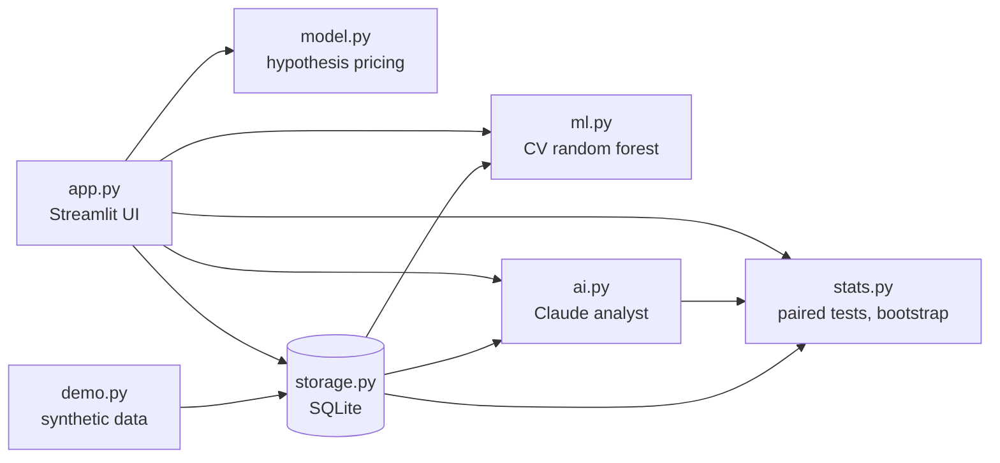

# 🚕 RideFair


A research toolkit for studying whether ride-hailing quotes differ by device,
battery level or network, built to be **methodologically honest**: it records
real quotes, simulates a transparent hypothesis model, tests the difference
with proper statistics, benchmarks it against ML, and uses an LLM as an
analyst that is constrained from over-claiming.

> **Disclaimer:** independent project, not affiliated with Uber or any
> ride-hailing company. The pricing model's coefficients are
> researcher-defined hypotheses, **not** verified company behaviour.

## Screenshots


## Highlights

| Area | What it does |
|---|---|
| Experiment capture | Device, OS, battery, charging, network, signal, ride type, route, traffic, demand, drivers, request time, quoted fare. Real quotes cannot be saved without the actual fare. |
| Hypothesis model | Explainable additive %-adjustment model with live fare and per-factor ₹ breakdown. Every coefficient is editable in the UI. |
| Statistics | Matched-pairs design, sign-flip permutation test, bootstrap CIs, Cohen's d, outlier detection (MAD z-score). |
| ML benchmark | Cross-validated random forest vs. hypothesis model vs. mean baseline, with permutation importance. |
| AI analyst | Claude-powered report, next-experiment planner and Q&A over **aggregated stats only**. Falls back to a rule-based report with no API key. |
| Persistence | SQLite, schema validation, legacy-CSV import, CSV export. |
| Engineering | Logic separated from UI, 23 tests, CI, Docker. |

## Architecture



The UI contains no business logic. Everything in `ridefair/` is importable
and unit-tested without Streamlit.

## Quick start

```bash
git clone https://github.com/<your-username>/ridefair.git
cd ridefair
python3 -m venv .venv
source .venv/bin/activate          # Windows: .venv\Scripts\activate
pip install -r requirements.txt
streamlit run app.py
```

Click **Demo data → Load demo data** in the sidebar to explore every page
without collecting quotes. Demo rows are always labelled `Simulated`.

### Enable the AI analyst (optional)

```bash
cp .env.example .env
export ANTHROPIC_API_KEY="your-key"     # or paste it in the app sidebar
```

Without a key, the app uses a deterministic rule-based report. Optional
override for the model: `export RIDEFAIR_MODEL=<model-name>`.

### Docker

```bash
docker build -t ridefair .
docker run -p 8501:8501 -e ANTHROPIC_API_KEY ridefair
```

### Tests

```bash
pip install -r requirements-dev.txt
pytest
```

## Project structure

```
app.py                 Streamlit UI
ridefair/
  config.py            levels and schema
  model.py             hypothesis pricing model
  storage.py           SQLite + validation + CSV import
  stats.py             paired tests, bootstrap, outliers, coverage gaps
  ml.py                cross-validated random forest benchmark
  ai.py                Claude analyst with fallback
  demo.py              synthetic demo data
tests/                 unit tests
docs/INTERVIEW.md      design decisions and talking points
```

## Design decisions

- **Matched pairs over naive averages.** Comparing all iPhone quotes with all
  Android quotes is confounded by route and time. Pairing on
  (route, ride type, 15-minute slot) cancels those effects.
- **Permutation tests and bootstrap, not t-tests.** Small, non-normal samples.
- **Real vs simulated is enforced in code,** not just labelled.
- **The LLM sees aggregates only,** receives data inside `<data>` tags, and is
  instructed to treat embedded text as data (prompt-injection hardening).
  Any API failure degrades to a deterministic report.
- **Importance is not causation.** The ML tab says so on screen.

## Limitations

Small hand-collected samples; uncontrolled factors (promotions, surge,
account history); the pricing model is a hypothesis; AI output is advisory.
See `docs/INTERVIEW.md` for more.

## Roadmap

- Mixed-effects model with route as a random effect
- Randomised device ordering and power analysis
- Postgres and authentication for multi-user collection

## License

MIT. See [LICENSE](LICENSE).
